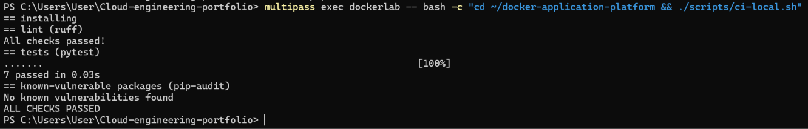
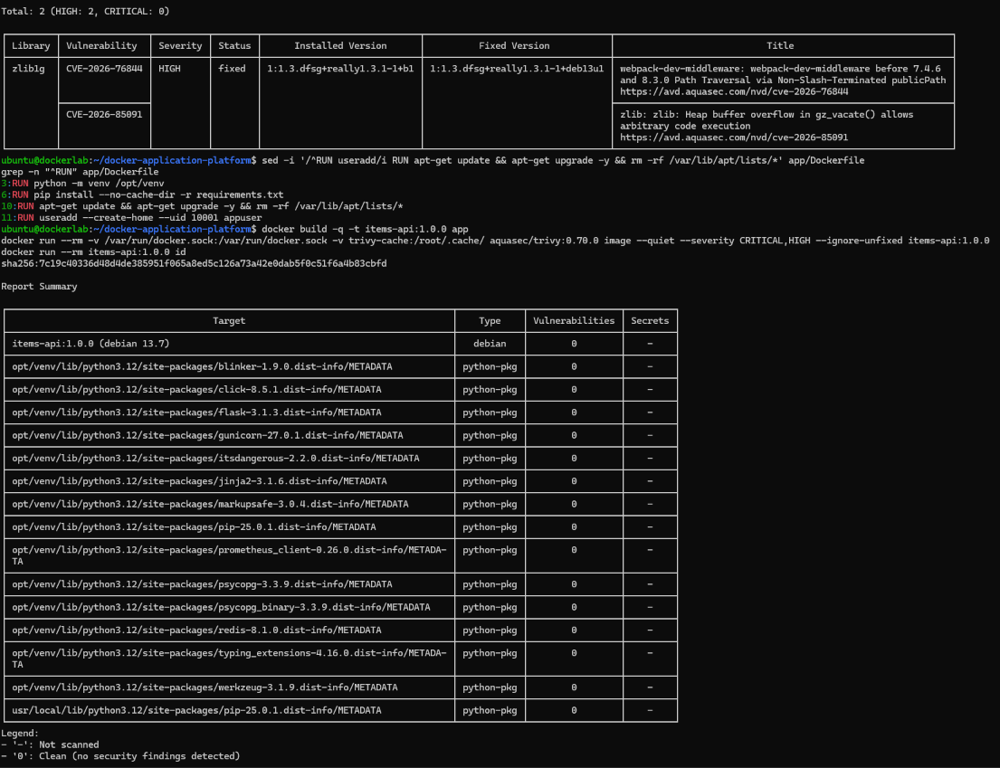
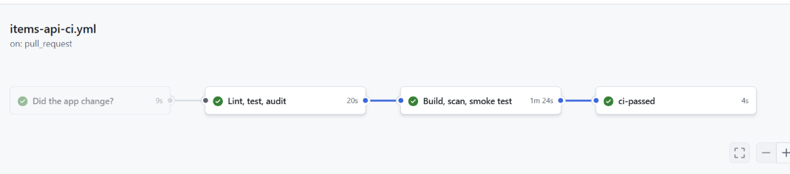
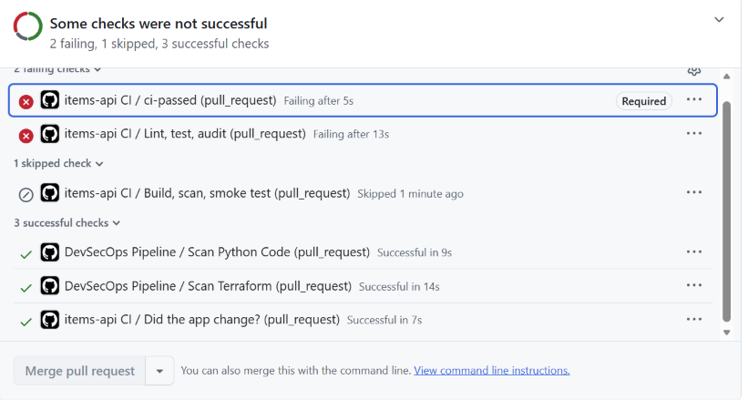
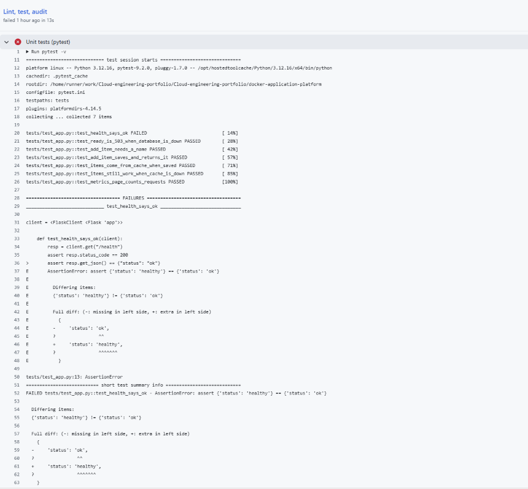
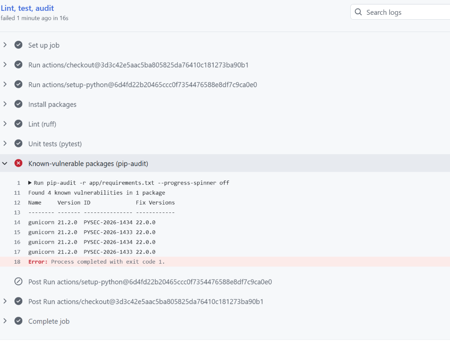
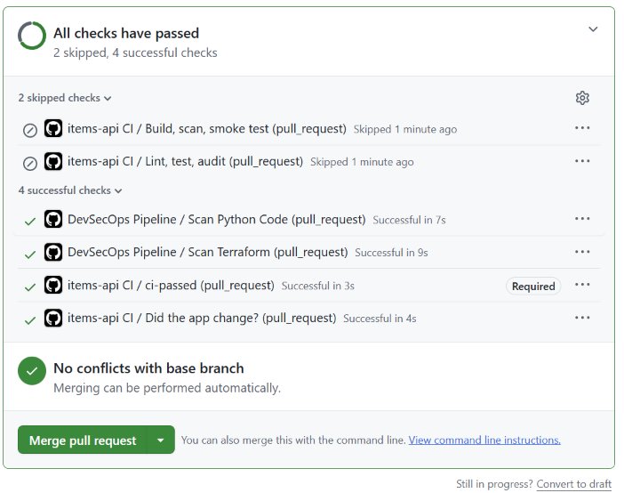

# CI Pipeline with GitHub Actions

## What I Built
A free CI pipeline in GitHub Actions for my Docker items API (../docker-application-platform). Every pull request to main is linted, unit tested, checked for known-vulnerable packages, built into a Docker image, scanned with Trivy, and started as the full four-container stack for a smoke test. main is protected, so a pull request can't merge until the pipeline passes.

## Tools Used
- GitHub Actions on GitHub-hosted Ubuntu 24.04 runners ($0 for a public repo)
- pytest with unittest.mock (7 unit tests, no database needed)
- ruff (lint)
- pip-audit (known-vulnerable Python packages)
- Trivy (image scan: Debian and Python packages)
- Docker and Docker Compose (image build and smoke test)
- GitHub branch protection with a required status check

## How It Works
    pull request to main
      -> Did the app change?   (skips the rest if nothing in docker-application-platform changed)
      -> Lint, test, audit     (ruff, pytest, pip-audit)
      -> Build, scan, smoke    (docker build, non-root check, Trivy, compose up, curl /health and /items)
      -> ci-passed             (red if any job failed; the one required check)

- Workflow: .github/workflows/items-api-ci.yml
- Least privilege: the workflow token is read-only (permissions: contents: read), and checkout doesn't keep it.
- Every third-party action is pinned to a full commit SHA, so its code can't change under me.
- No secrets: the smoke test uses .env.example's fake passwords.
- The smoke test runs the exact image that was scanned.
- The same checks run locally with ../docker-application-platform/scripts/ci-local.sh.

## Steps
1. Wrote 7 pytest unit tests that mock Postgres and Redis, including the database-down and cache-down paths.
2. Wrote scripts/ci-local.sh to run lint, tests and pip-audit in a throwaway container.
3. Scanned the image with Trivy: 2 HIGH CVEs in zlib from the Debian base image. Added apt-get upgrade to the final build stage, and the rescan was clean.
4. Wrote the GitHub Actions workflow with four jobs, path-based skipping and SHA-pinned actions.
5. Made ci-passed a required status check on main, with no bypass.
6. Broke the pipeline on purpose twice and fixed it (tickets below).

## Screenshots

### 01 - Checks Passing Locally

Lint, 7 unit tests and pip-audit passing in a throwaway container before pushing.

### 02 - Image Scan Clean

Trivy finds no fixable HIGH or CRITICAL vulnerabilities after patching the base image.

### 03 - Pipeline Green

All four jobs passing on the pull request.

### 04 - Merge Blocked

A failing check blocks the merge because ci-passed is required.

### 05 - Ticket A: Failing Test

The health check test expected ok and got healthy.

### 06 - Ticket B: Vulnerable Package

pip-audit flags gunicorn 21.2.0 with 4 known vulnerabilities, fixed in 22.0.0.

### 07 - Pipeline Fixed

ci-passed green again and the pull request can merge. Tests show skipped because the fix put the code back to match main.

## Troubleshooting Tickets

### Ticket A: "A small change broke the health check"
- **What broke:** a pull request changed /health to answer {"status": "healthy"}. The pipeline went red and the merge was blocked.
- **How I found it:** opened the failed "Lint, test, audit" job, then the "Unit tests (pytest)" step. The health check test failed: it expected "ok" and got "healthy".
- **Cause:** the load balancer and monitoring expect "ok". The change broke that promise, and the test caught it.
- **Fix:** changed it back, ran scripts/ci-local.sh (7 passed), pushed, pipeline green.

### Ticket B: "Someone pinned an old package"
- **What broke:** a pull request pinned gunicorn to 21.2.0. Lint and tests passed, but the pipeline went red.
- **How I found it:** the "Known-vulnerable packages (pip-audit)" step listed 4 known vulnerabilities in gunicorn 21.2.0 with fix version 22.0.0.
- **Cause:** an old version with published CVEs. The app still worked, which is why a separate security check is needed.
- **Fix:** put back gunicorn>=22.0, confirmed locally with pip-audit, pushed, pipeline green.

## What I Learned
- Read a failed pipeline in order: which job, which step, which line, expected versus actual.
- Working and safe are different checks: tests passed while pip-audit failed.
- Most image vulnerabilities came from the base image, not my code, and patching at build time fixes them.
- Pin third-party actions to a commit SHA, and give the workflow token only read access.
- Make one aggregate check required, so skipped jobs don't block unrelated pull requests.

## Run It Yourself
    cd docker-application-platform
    ./scripts/ci-local.sh            # lint, tests and pip-audit in a throwaway container
    docker build -t items-api:1.0.0 app
    docker run --rm -v /var/run/docker.sock:/var/run/docker.sock aquasec/trivy:0.70.0 image --severity CRITICAL,HIGH --ignore-unfixed items-api:1.0.0
