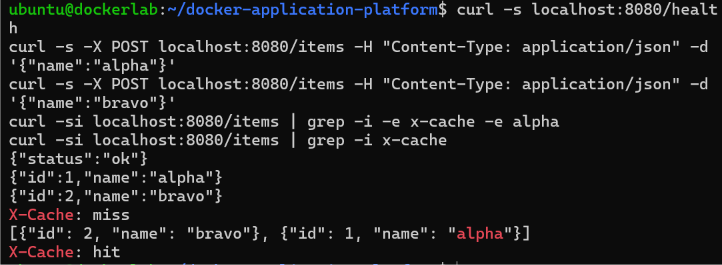
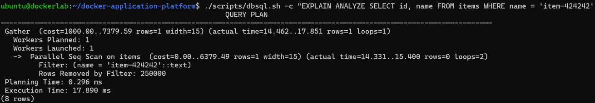
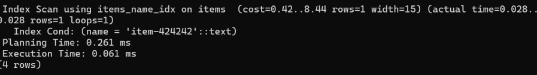
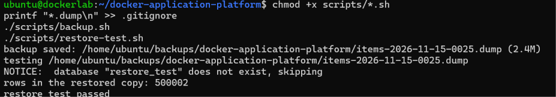
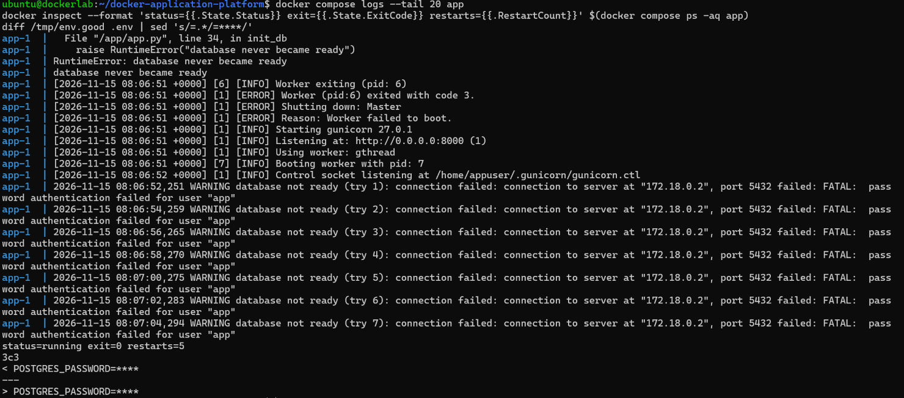
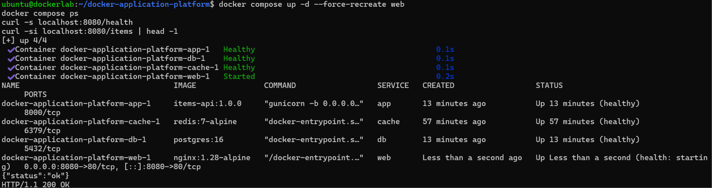

# Docker Application Platform

## What I Built
A small items API (Python and Flask) running in Docker the way a real team runs it: Nginx in front, PostgreSQL for data and Redis as a cache, with only Nginx reachable from outside. I then made a slow database search fast with an index, added a read-only database login and tested nightly backups, and fixed a container that wouldn't start.

## Tools Used
- Docker Engine and Docker Compose on Ubuntu 24.04 (a Multipass VM on Windows 11)
- Python 3.12, Flask and Gunicorn
- Nginx 1.28 as the reverse proxy
- PostgreSQL 16: roles and grants, EXPLAIN ANALYZE, indexes, pg_dump and pg_restore
- Redis 7 as a cache
- Prometheus client (a /metrics endpoint for the monitoring project)
- Bash and cron for backups

## How It Works
    visitor -> port 8080 -> web (Nginx) -> app (Flask, port 8000) -> db (PostgreSQL)
                                                                 -> cache (Redis)

    frontend network: web, app
    backend network (internal, no way in or out): app, db, cache

- Only web publishes a port. db and cache have no ports and sit on an internal network.
- The app runs as a normal user (uid 10001) from a multi-stage image.
- Start-up order follows health checks: the app waits for a healthy database and cache, and Nginx waits for a healthy app.
- GET /items checks Redis first (X-Cache: hit) and falls back to the database (X-Cache: miss). If Redis is down, the app still works.
- Reports use a separate reporter login that can only read the items table.

## Steps
1. Wrote a Flask API with /health, /ready, /items and /metrics.
2. Built a multi-stage, non-root image (items-api:1.0.0).
3. Wrote a Compose file with four services, two networks and health checks.
4. Proved only port 8080 is open and the app runs as uid 10001.
5. Added a read-only reporter login (db/reporter-role.sql) and showed a DELETE is refused.
6. Loaded 500,000 test rows (db/load-test-rows.sql) and timed a search by name with EXPLAIN ANALYZE: Seq Scan, 17.890 ms.
7. Added an index on name (db/add-name-index.sql): Index Scan, 0.061 ms, about 290 times faster.
8. Wrote scripts/backup.sh (pg_dump, keeps 7 copies), scheduled it nightly with cron, and proved a backup restores with scripts/restore-test.sh.
9. Broke the stack on purpose and fixed it (ticket below).

## Screenshots

### 01 - All Containers Running (Docker Compose)

All four services are up and healthy, and the cache shows a miss and then a hit.

### 03 - Slow Search Before Index

Searching 500,000 rows by name used a Seq Scan and took 17.890 ms.

### 04 - Fast Search After Index

The same search used an Index Scan and took 0.061 ms.

### 05 - Backup and Restore Test

pg_dump saved the database, and the restore test loaded it into a scratch database with the same 500,002 rows.

### 06 - Ticket: Container Startup Error

The app was stuck restarting (exit code 3, restart count climbing) because the database rejected its password.

### 07 - Ticket: Fixed

All four services healthy again and the site answering 200 OK.

## Troubleshooting Tickets

### Ticket 1: "The container won't start" (bad setting, port in use, then a lost network)
- **What broke:** the site returned 502 Bad Gateway and the app container kept restarting. After that was fixed, Nginx itself wouldn't start, and then it started and quit with "host not found in upstream app".
- **How I found it:** docker compose ps showed app Restarting. docker compose logs app showed "password authentication failed for user app" ten times, then "Worker failed to boot". docker inspect showed 74 restarts. A diff of .env against the last good copy, with values masked, showed only POSTGRES_PASSWORD had changed. For the second cause, docker compose up failed with "port is already allocated", the web logs were empty because it never started, and ss plus docker ps --filter publish=8080 showed another container holding the port. For the third, docker compose ps -a showed web Exited (1) and its logs said it couldn't find the app by name.
- **Cause:** first, the password in .env no longer matched the database. Postgres only reads POSTGRES_PASSWORD when it first creates its data folder, so changing .env later doesn't change the real password. Second, port 8080 was already taken by another container. Third, the failed start left the old web container without a working connection to the app's network.
- **Fix:** restored the good .env, recreated the app and restarted Nginx. Removed the container holding 8080. Recreated web with docker compose up -d --force-recreate web, which rebuilt it on the right networks. In production I'd change a password in the database (ALTER ROLE) and the secret store together, and keep port assignments in one place.

## What I Learned
- Logs first, then docker inspect: logs show what the program said, inspect shows what Docker recorded (exit code, restart count, last error), even when there are no logs.
- An index turns reading every row into a quick lookup. The cost is disk space and slightly slower writes.
- A backup only counts once you've restored it.
- Least privilege applies inside the database too: reports get a read-only login.
- Restarting a container keeps its old setup. Recreating it builds a clean one, which fixes broken network connections.

## Run It Yourself
    cp .env.example .env          # then put real passwords in .env
    docker compose up -d --build
    curl localhost:8080/health
    docker compose down           # stop, keep the data
    docker compose down -v        # stop and delete the data
