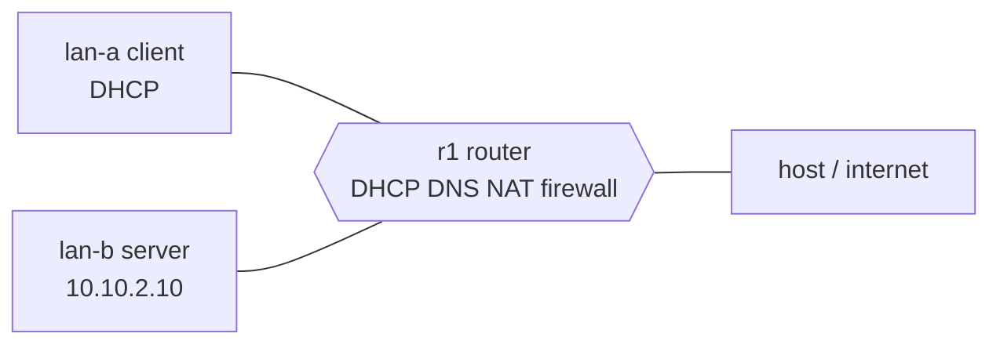

# Network Engineering Lab

A small company network built on one Linux VM with network namespaces: a client LAN, a server LAN and a router that hands out addresses (DHCP), answers names (DNS), shares one internet connection (NAT) and runs a default-deny firewall. Then I broke it four ways on purpose and fixed each one with a layered method and packet evidence.

## Diagram


## Address plan
| Segment | Subnet | Router address | Notes |
|---|---|---|---|
| LAN A (clients) | 10.10.1.0/24 | 10.10.1.1 | clients get 10.10.1.50-100 by DHCP |
| LAN B (server) | 10.10.2.0/24 | 10.10.2.1 | server fixed at 10.10.2.10 |
| WAN link | 10.10.0.0/30 | 10.10.0.2 (router) / 10.10.0.1 (host) | router reaches the internet through the host |

## What I tested
| Test | Expected | Result |
| --- | --- | --- |
| Laptop opens the website | 200 | web: 200 |
| Laptop to server SSH (22) | Times out (blocked) | timed out |
| Laptop to the internet | 200 through NAT | internet: 200 |
| Server pings the laptop | Blocked | 100% packet loss |
| Laptop pings the server | Blocked (not web traffic) | 100% packet loss |

Before the firewall, SSH said "connection refused". After it, SSH timed out. Refused means nothing is listening; a timeout means a firewall dropped it.

## What a capture shows
A tcpdump capture on the router's LAN A side, opened in Wireshark:
- **DHCP Discover, Offer, Request, ACK:** the laptop asks for an address and gets 10.10.1.71 from the router.
- **ARP "who has 10.10.1.1?":** the laptop finds the router's hardware address.
- **DNS A? web.lab.internal, answer 10.10.2.10:** the router answers for its own zone.
- **TCP SYN, SYN-ACK, ACK, then GET / and 200 OK:** a full website visit.

## Four things I broke and fixed
Full write-ups in [BREAK-FIX.md](BREAK-FIX.md).
1. **DNS stopped:** "connection refused" on port 53; restarted the DNS service.
2. **Default route missing:** "Network is unreachable"; renewed the DHCP lease to get the gateway back.
3. **Firewall rule removed:** the website timed out; proved it with a capture on both sides of the router and the drop counter, then reloaded the saved rules.
4. **Broad allow rule on top:** the server could reach the laptop; found it by rule order and handle number and deleted it.

## How I troubleshoot
Name, route, reach, port, service, in that order. See the flowchart in [docs/decision-tree.md](docs/decision-tree.md).

## How this maps to AWS
| In this lab | In AWS |
| --- | --- |
| A LAN | A subnet |
| The router's nftables firewall | A security group plus a network ACL |
| Masquerade (NAT) | A NAT gateway |
| dnsmasq DHCP and DNS | VPC DHCP options plus a Route 53 private hosted zone |
| tcpdump on both sides | VPC Flow Logs or Traffic Mirroring |

## Run it yourself
On an Ubuntu VM with dnsmasq, busybox, nftables and tcpdump installed:
```bash
sudo bash scripts/start-lab.sh   # builds everything and starts the web server
sudo bash scripts/teardown.sh    # removes everything
```
It all runs locally, so it costs nothing.

## Proof
| What | Screenshot |
|---|---|
| Namespaces and pings | [01](screenshots/01-namespaces-and-pings.png) |
| DHCP lease | [02](screenshots/02-dhcp-lease.png) |
| DNS lookup | [03](screenshots/03-dns-lookup.png) |
| Ticket 1: DNS broken and fixed | [04](screenshots/04-ticket-dns-broken.png), [05](screenshots/05-ticket-dns-fixed.png) |
| Firewall tests and counters | [06](screenshots/06-firewall-tests.png), [07](screenshots/07-firewall-counters.png) |
| Capture: DHCP, DNS, TCP handshake | [P2-06](screenshots/P2-06-capture-dhcp.png), [P2-07](screenshots/P2-07-capture-dns.png), [P2-08](screenshots/P2-08-capture-tcp-handshake.png) |
| Ticket 2: route broken and fixed | [11](screenshots/11-ticket-routing-broken.png), [12](screenshots/12-ticket-routing-fixed.png) |
| Ticket 3: firewall evidence and fix | [13](screenshots/13-ticket-firewall-evidence.png), [14](screenshots/14-ticket-firewall-fixed.png) |
| Ticket 4: rule order | [15](screenshots/15-ticket-rule-order.png) |
| Clean teardown | [16](screenshots/16-teardown-clean.png) |

## Next steps
VLANs on pfSense, and a WireGuard VPN between the two LANs.
